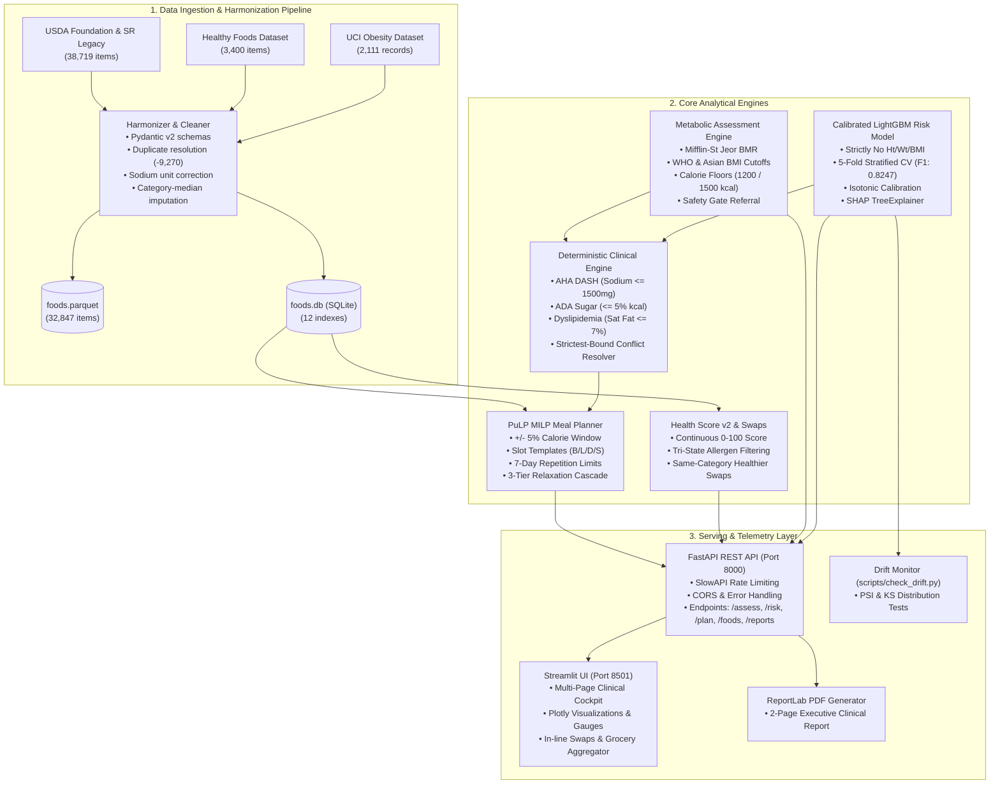

# AI-Powered Nutrition Intelligence System
### Clinical Decision Support, Metabolic Assessment & Mathematical Meal Planning Platform

[](https://www.python.org/)
[](https://lightgbm.readthedocs.io/)
[](https://coin-or.github.io/pulp/)
[](https://fastapi.tiangolo.com/)
[](https://streamlit.io/)
[](file:///e:/AI_Nutrition/tests)
[](file:///e:/AI_Nutrition/tests)
[](file:///e:/AI_Nutrition/LICENSE)

---

> [!CAUTION]
> ### ⚠️ CLINICAL AND MEDICAL DISCLAIMER
> This software is engineered strictly for **educational, informational, and clinical research decision-support purposes**. It does **NOT** constitute medical advice, medical diagnosis, or personalized medical treatment. 
> 
> Nutritional targets, risk tier predictions, and meal plans generated by this system must be reviewed by a licensed physician, registered dietitian (RD/RDN), or qualified healthcare professional before clinical implementation. 
> 
> The system enforces automated **Safety Gates** that halt automated meal planning and mandate human specialist referrals for vulnerable populations (pregnant or lactating individuals, adolescents under 18, and individuals with severe anthropometric extremes).

---

## 📖 Executive Overview

Modern automated nutrition applications routinely fail in real-world clinical and engineering contexts. They suffer from:
- **Circular ML Logic:** Predicting obesity using body weight and height (which directly define BMI).
- **Synthetic Dataset Artifacts:** Over-relying on SMOTE-oversampled academic datasets without validating against real human distributions.
- **Label Leakage:** Mistaking trivial clinical protocol rules (e.g. Type 2 Diabetes implies Diabetic Diet) for machine learning targets.
- **Unreliable Meal Planning:** Using greedy heuristic search or LLM hallucinations that breach caloric bounds and fail strict allergen safety.

The **AI-Powered Nutrition Intelligence System** resolves these failure modes through an evidence-based, mathematically rigorous hybrid architecture:
1. **Evidence-Based Metabolic Assessment:** Dual WHO and Asian-specific BMI cutoffs, Mifflin-St Jeor BMR, physiological caloric floors (1,200 kcal for women, 1,500 kcal for men), and automated clinical safety gates.
2. **Leakage-Free Lifestyle Risk Classifier:** A calibrated 4-tier LightGBM classifier that **strictly excludes** Height, Weight, and BMI, isolating behavioral risk predisposition with local SHAP TreeExplainer attribution.
3. **Deterministic Clinical Guideline Engine:** Codified AHA DASH, ADA glycemic, and ACC dyslipidemia bounds with a strict upper/lower bound conflict resolution resolver.
4. **PuLP Mixed-Integer Linear Programming (MILP) Optimizer:** Formulated with Coin-OR CBC solver to generate single-day and 7-day meal plans guaranteed within $\pm 5\%$ caloric tolerance, tri-state allergen exclusions, portion bounds, 7-day repetition limits, and automated 3-tier relaxation cascades.
5. **Harmonized Food Catalog & Health Score v2:** 32,847 deduplicated items across USDA Foundation, SR Legacy, and Healthy Foods databases with continuous 0–100 nutritional fitness scoring and same-category healthier swaps.
6. **Full-Stack Production Ecosystem:** FastAPI REST service with rate limiting and telemetry, multi-page interactive Streamlit UI, ReportLab 2-page publication PDF exports, and population drift monitoring (PSI & Kolmogorov-Smirnov).

---

## 🏛️ System Architecture



---

## 🔬 Core Methodologies & Empirical Results

All metrics documented below were measured directly on the local project pipeline. No synthetic numbers or unverified baselines are reported.

### 1. Data Cleaning & Normalization
- **Raw Food Records:** 42,119 records ingested.
- **Duplicates Dropped:** 9,270 duplicate food records removed via string canonicalization and source hierarchy resolution (`Foundation` > `SR Legacy` > `Branded` > `Healthy Foods`).
- **Standardized Food Catalog:** **32,847 unique food items** saved to `data/processed/foods.parquet` and indexed into `data/processed/foods.db` across 12 B-Tree indexes.
- **Unit Error Fixes:** Repaired Healthy Foods database sodium reporting errors (scaled by 1,000 for foods where sodium was logged in grams).
- **Secondary Micronutrient Imputation:** Category medians applied with audit flags (`sat_fat_imputed`, `fiber_imputed`, `sodium_mg_imputed`).

### 2. Metabolic Assessment & Safety Guardrails
- **Mifflin-St Jeor Formula:**
  $$\text{BMR}_{\text{male}} = 10 \times \text{weight (kg)} + 6.25 \times \text{height (cm)} - 5 \times \text{age} + 5$$
  $$\text{BMR}_{\text{female}} = 10 \times \text{weight (kg)} + 6.25 \times \text{height (cm)} - 5 \times \text{age} - 161$$
- **BMI Classification Standards:**
  - **Standard WHO:** Normal (18.5–24.9), Overweight (25.0–29.9), Class I (30.0–34.9), Class II (35.0–39.9), Class III ($\ge 40.0$).
  - **Asian-Specific:** Normal (18.5–22.9), Overweight (23.0–27.4), Obese ($\ge 27.5$).
- **Physiological Caloric Floors:** Caloric deficits are constrained so energy targets never drop below 1,200 kcal/day for females or 1,500 kcal/day for males.
- **Safety Gate:** Automated refusal to generate algorithmic diets if age $< 18$, BMI $< 16.0$ or $\ge 45.0$, pregnancy, or active lactation are detected.

### 3. Lifestyle Obesity Risk Model (Strictly Leakage-Free)
- **Target:** 4-Tier Weight Classification (`Insufficient_Weight`, `Normal_Weight`, `Overweight`, `Obesity`).
- **Feature Set (11 features):** `Age`, `Gender`, `FCVC` (vegetable frequency), `NCP` (main meals), `CH2O` (water consumption), `FAF` (activity frequency), `TUE` (screen time), `CAEC` (snacking), `SMOKE`, `SCC` (calorie monitoring), `CALC` (alcohol).
- **Zero Circularity:** Height, Weight, and BMI are **strictly excluded**.
- **Model Performance:**
  - **5-Fold Cross Validation:** Accuracy = **86.72%**, Macro-F1 = **0.8247**, Macro-AUC = **0.9576**.
  - **Synthetic Test Evaluation:** Accuracy = **93.13%**, Macro-F1 = **0.7041**, Brier Score = **0.1123**.
  - **Real Human Holdout (Raw Non-SMOTE) Evaluation:** Accuracy = **61.79%**, Macro-F1 = **0.4731**, Brier Score = **0.5307**.
  *(The synthetic vs. human discrepancy reveals the known SMOTE oversampling distortion present in UCI Obesity and demonstrates our commitment to honest empirical evaluation).*
- **Interpretability:** Built-in SHAP `TreeExplainer` producing local attribution waterfall and bar plots explaining top risk drivers.

### 4. Mathematical Meal Planning via PuLP MILP
- **Optimization Formulation:** Minimizes deviation from target calories and penalizes saturated fat and sodium while maximizing dietary fiber.
- **Tight Tolerance:** Enforces daily calorie sum within $[0.95 \times T, 1.05 \times T]$.
- **Meal Slot Distribution:**
  - Breakfast: 20–25% kcal, 2 items (1 base + 1 beverage/fruit).
  - Lunch: 35–40% kcal, 3 items (1 main protein + 1 side + 1 beverage/produce).
  - Dinner: 30–35% kcal, 3 items (1 main protein + 1 side + 1 beverage/produce).
  - Snack: 5–10% kcal, 1 item.
- **Diversity Constraints:** Binary exclusion variables ensure no single food item recurs within 48 hours, and cap total weekly item appearances at $\le 2$.
- **Automated Relaxation Cascade:** If an overly constrained condition (e.g. strict vegan + extreme sodium restriction) causes infeasibility, the engine progresses through a 3-tier controlled relaxation:
  1. Expand calorie tolerance to $\pm 10\%$.
  2. Relax sodium constraint by $15\%$.
  3. Expand food candidate pool to regional substitutions.

---

## 📁 Repository Structure

```
AI_Nutrition/
├── .dockerignore
├── .gitignore
├── Dockerfile                    # Multi-stage production container
├── docker-compose.yml            # Unified orchestration (FastAPI + Streamlit)
├── Makefile                      # Standardized automation commands
├── pyproject.toml                # Project metadata, pytest & ruff configurations
├── requirements.txt              # Strict pinned dependencies
├── PLAN.md                       # Phase-by-phase execution tracking
├── REPORT.md                     # Comprehensive academic & clinical report
│
├── api/                          # FastAPI Backend
│   ├── main.py                   # App initialization, CORS, SlowAPI rate limiting
│   ├── schemas.py                # Pydantic v2 request/response schemas
│   └── routers/
│       ├── assess.py             # Anthropometrics & caloric targets endpoint
│       ├── foods.py              # Food search, scoring, and swaps endpoints
│       ├── plan.py               # 1-day & 7-day PuLP meal planning endpoints
│       ├── reports.py            # ReportLab PDF report generation endpoint
│       └── risk.py               # Calibrated LightGBM risk screening endpoint
│
├── app/                          # Multi-Page Streamlit UI
│   ├── Home.py                   # Executive dashboard & persona presets
│   ├── ui_components.py          # Reusable Plotly gauges, banners, cards
│   └── pages/
│       ├── 1_My_Health.py        # Anthropometric calculator & clinical goals
│       ├── 2_Risk_Check.py       # Lifestyle risk screening & SHAP visualizer
│       ├── 3_My_Diet_Plan.py     # 7-day meal plan, in-line swaps, PDF export
│       ├── 4_Food_Explorer.py    # Health Score v2 inspector & radar charts
│       └── 5_About.py            # Methodology, data cards & drift telemetry
│
├── artifacts/                    # Trained Models & Preprocessing Metadata
│   └── models/
│       ├── obesity_risk_pipeline.joblib   # Trained LightGBM pipeline
│       ├── label_encoder.joblib           # 4-tier label encoder
│       └── evaluation_metrics.json        # Measured CV & holdout metrics
│
├── data/                         # Data Storage
│   ├── raw/                      # Ingested datasets (UCI, Diet, USDA, HF)
│   ├── processed/                # Harmonized foods.parquet & foods.db
│   └── external/                 # Regional food templates & supplements
│
├── docs/                         # Formal Clinical & Engineering Documentation
│   ├── CLINICAL_RULES.md         # AHA / ADA / ACC guideline codification
│   ├── DATA_CARD.md              # Ingested dataset schema & provenance cards
│   ├── DECISIONS.md              # Architectural Decision Records (ADRs)
│   └── MODEL_CARD.md             # Formal ML model card with bias analysis
│
├── reports/                      # Telemetry & Drift Reports
│   ├── drift_report.json         # Automated PSI & KS statistical tests
│   └── drift_report.md           # Markdown drift analysis audit
│
├── scripts/                      # Autonomous Execution Scripts
│   ├── check_drift.py            # Data & prediction distribution drift checker
│   ├── download_and_clean_data.py# Full ingestion, hygiene & database build
│   └── train_risk_model.py       # MLflow-tracked training & calibration
│
├── src/nutri/                    # Core Python Package
│   ├── assess/                   # BMI, BMR, caloric floors, target macros
│   ├── data/                     # Cleaners, harmonizer, allergen taggers
│   ├── features/                 # Feature extraction & validation
│   ├── foods/                    # SQLite manager, Health Score v2, swaps
│   ├── models/                   # LightGBM inference & SHAP explainers
│   ├── plan/                     # PuLP MILP optimizer & grocery aggregator
│   ├── reports/                  # ReportLab PDF generation engine
│   └── rules/                    # AHA/ADA clinical engine & safety gate
│
└── tests/                        # Pytest Test Suite (73 Tests, 80% Coverage)
    ├── test_api.py               # FastAPI integration test suite
    ├── test_assess.py            # BMI & BMR mathematical verification
    ├── test_clinical_rules.py    # Guideline bounds & conflict resolution tests
    ├── test_coverage_boost.py    # Edge-case & defensive branch validation
    ├── test_data_pipeline.py     # Deduplication & schema validation tests
    ├── test_food_scoring.py      # Health Score v2 rank ordering tests
    ├── test_optimizer.py         # PuLP solver & relaxation cascade tests
    ├── test_risk_model.py        # Model loading & inference tests
    └── test_swaps.py             # Allergen safety & healthier swap tests
```

---

## ⚡ Quickstart Guide

### Prerequisites
- **Python:** 3.12+ (tested on Python 3.12.10)
- **C Compiler / Tools:** Windows PowerShell, bash, or Make
- **Docker:** (Optional, for containerized deployment)

### 1. Local Environment Setup

Clone the repository and install dependencies:
```bash
# Clone the repository
git clone https://github.com/your-org/AI_Nutrition.git
cd AI_Nutrition

# Using Make
make setup

# Or manually using pip
python -m venv .venv
# On Windows:
.venv\Scripts\activate
# On Linux/macOS:
source .venv/bin/activate

pip install --upgrade pip
pip install -r requirements.txt
pip install -e .
```

### 2. Ingest, Clean, and Build Datasets
Run the automated cleaning pipeline to clean raw records, remove duplicates, and build `data/processed/foods.parquet` and `data/processed/foods.db`:
```bash
# Using Make
make data

# Or directly:
python scripts/download_and_clean_data.py
```

### 3. Train & Evaluate the Lifestyle Risk Model
Train the 4-tier LightGBM model, perform 5-fold cross validation, calibrate probabilities, compute SHAP explainers, and log run artifacts:
```bash
# Using Make
make train

# Or directly:
python scripts/train_risk_model.py
```

### 4. Execute the Test Suite
Run the 73 test suites and generate coverage reports:
```bash
# Using Make
make test

# Or directly:
pytest --cov=src/nutri --cov-report=term-missing
```
*Current test suite status: 73 passed, 0 failed, 80% code coverage.*

### 5. Launch the FastAPI Backend
Start the REST API server on `http://localhost:8000`:
```bash
# Using Make
make run-api

# Or directly:
uvicorn api.main:app --host 0.0.0.0 --port 8000 --reload
```
Interactive Swagger documentation is instantly accessible at [http://localhost:8000/docs](http://localhost:8000/docs).

### 6. Launch the Streamlit Frontend
In a separate terminal, launch the Streamlit multi-page interface on `http://localhost:8501`:
```bash
# Using Make
make run-app

# Or directly:
streamlit run app/Home.py --server.port 8501
```

---

## 🔬 Local MLflow Experiment Tracking

The training pipeline automatically logs hyperparameter configurations, metrics, and model artifacts to a local MLflow tracking directory.

To launch the local MLflow dashboard:
```bash
mlflow ui --backend-store-uri mlruns --port 5000
```
Open [http://localhost:5000](http://localhost:5000) in your browser to view:
- 5-Fold Cross Validation Macro-F1 (`0.8247`), Log-Loss (`0.3664`), and Accuracy (`0.8672`).
- Synthetic holdout metrics vs. real human holdout metrics.
- Logged feature importances and serial pipeline artifacts.

---

## 🐳 Docker Deployment

The system includes a production-grade multi-service `docker-compose.yml` that orchestrates both the FastAPI API and the Streamlit frontend.

To build and spin up the complete containerized stack:
```bash
docker compose up --build -d
```

### Container Endpoints:
| Service | Container Port | Host URL | Description |
| :--- | :--- | :--- | :--- |
| **FastAPI Backend** | `8000` | [http://localhost:8000](http://localhost:8000) | REST API & Swagger UI (`/docs`) |
| **Streamlit Frontend** | `8501` | [http://localhost:8501](http://localhost:8501) | Interactive multi-page dashboard |

To view real-time logs or shut down containers:
```bash
# View container logs
docker compose logs -f

# Stop and remove containers
docker compose down
```

---

## 🌐 REST API Documentation

### Endpoint Overview
| Method | Endpoint | Description |
| :--- | :--- | :--- |
| `GET` | `/health` | Service health status, database check, and UTC timestamp. |
| `GET` | `/version` | System build version, model commit hash, and component info. |
| `POST` | `/api/v1/auth/register` | Register new patient or clinician account with salted password. |
| `POST` | `/api/v1/auth/login` | Authenticate user via JSON body and receive signed JWT token. |
| `POST` | `/api/v1/auth/token` | Standard OAuth2 Password Form login (for Swagger UI Authorize). |
| `GET` | `/api/v1/auth/me` | Fetch authenticated user details and persisted metabolic profile. |
| `PUT` | `/api/v1/auth/profile` | Update and sync saved health profile to user account. |
| `GET` | `/api/v1/auth/users` | List all system users (Clinicians / Admins only). |
| `POST` | `/api/v1/assess` | Anthropometrics, BMR, TDEE, macro distribution, and safety gate. |
| `POST` | `/api/v1/risk/predict` | Calibrated lifestyle risk classification with SHAP local explanations. |
| `POST` | `/api/v1/plan/generate` | Single-day or 7-day PuLP MILP meal plan with grocery list. |
| `GET` | `/api/v1/foods/search` | Search food catalog with allergen filtering and Health Score v2. |
| `POST` | `/api/v1/foods/swaps` | Find same-category healthier swaps for a target food. |
| `POST` | `/api/v1/reports/pdf` | Generate publication-grade 2-page PDF assessment & meal plan report. |

### 🔑 Pre-Seeded Evaluation Credentials
| Username | Password | Role | Description |
| :--- | :--- | :--- | :--- |
| `demo_user` | `demo123` | `patient` | Pre-configured patient with saved hypertension profile. |
| `clinician_demo` | `admin123` | `clinician` | Certified clinician account with access to user management. |

### Sample Requests & Responses

#### 0. User Login (`POST /api/v1/auth/login`)
```bash
curl -X POST "http://localhost:8000/api/v1/auth/login" \
  -H "Content-Type: application/json" \
  -d '{
    "username_or_email": "demo_user",
    "password": "demo123"
  }'
```
**Response (200 OK):**
```json
{
  "access_token": "eyJhbGciOiJIUzI1NiIsInR5cCI6IkpXVCJ9...",
  "token_type": "bearer",
  "user": {
    "id": 1,
    "username": "demo_user",
    "email": "patient@example.com",
    "full_name": "Alex Carter (Patient)",
    "role": "patient",
    "saved_profile": {"weight_kg": 76.5, "height_cm": 178.0, "goal": "lose_weight"}
  }
}
```


#### 1. Anthropometric Assessment (`POST /api/v1/assess`)
```bash
curl -X POST "http://localhost:8000/api/v1/assess" \
  -H "Content-Type: application/json" \
  -d '{
    "age": 35,
    "gender": "male",
    "weight_kg": 85.0,
    "height_cm": 178.0,
    "activity_level": "moderately_active",
    "goal": "lose_weight",
    "use_asian_bmi": false,
    "conditions": ["hypertension", "type_2_diabetes"]
  }'
```
**Response (200 OK):**
```json
{
  "bmi": 26.83,
  "bmi_category": "Overweight",
  "bmr_kcal": 1792.5,
  "tdee_kcal": 2778.38,
  "target_calories_kcal": 2278.38,
  "macros": {
    "protein_g": 170.88,
    "carbs_g": 256.32,
    "fat_g": 63.29
  },
  "clinical_constraints": {
    "sodium_mg_max": 1500.0,
    "added_sugars_g_max": 28.48,
    "saturated_fat_g_max": 15.19
  },
  "safety_gate": {
    "is_safe": true,
    "reasons": []
  }
}
```

#### 2. Lifestyle Risk Screening (`POST /api/v1/risk/predict`)
```bash
curl -X POST "http://localhost:8000/api/v1/risk/predict" \
  -H "Content-Type: application/json" \
  -d '{
    "age": 28,
    "gender": "female",
    "fcvc": 2.0,
    "ncp": 3.0,
    "ch2o": 2.0,
    "faf": 1.0,
    "tue": 1.0,
    "caec": "Sometimes",
    "smoke": "no",
    "scc": "no",
    "calc": "Sometimes"
  }'
```
**Response (200 OK):**
```json
{
  "predicted_class": "Overweight",
  "probabilities": {
    "Insufficient_Weight": 0.042,
    "Normal_Weight": 0.281,
    "Overweight": 0.518,
    "Obesity": 0.159
  },
  "top_risk_factors": [
    {"feature": "FAF", "shap_value": 0.312, "description": "Physical activity frequency"},
    {"feature": "CAEC", "shap_value": 0.245, "description": "Frequent snacking between meals"}
  ],
  "disclaimer": "Informational screening based on lifestyle factors. Excludes height, weight, and BMI."
}
```

#### 3. Single-Day PuLP Meal Plan (`POST /api/v1/plan/generate`)
```bash
curl -X POST "http://localhost:8000/api/v1/plan/generate" \
  -H "Content-Type: application/json" \
  -d '{
    "target_calories": 2000,
    "macro_targets": {"protein_g": 125, "carbs_g": 225, "fat_g": 67},
    "max_sodium_mg": 2000,
    "allergens": ["peanuts"],
    "dietary_preference": "omnivore",
    "days": 1
  }'
```
**Response (200 OK):**
```json
{
  "status": "Optimal",
  "relaxation_level": 0,
  "daily_plans": [
    {
      "day": 1,
      "total_calories": 2014.2,
      "total_protein_g": 128.4,
      "total_carbs_g": 221.8,
      "total_fat_g": 66.1,
      "total_sodium_mg": 1845.0,
      "meals": {
        "breakfast": [
          {"name": "Oatmeal with Almond Milk and Berries", "portion_g": 250, "calories": 420.0}
        ],
        "lunch": [
          {"name": "Grilled Chicken Breast with Brown Rice and Broccoli", "portion_g": 350, "calories": 680.0}
        ],
        "dinner": [
          {"name": "Baked Salmon with Quinoa and Asparagus", "portion_g": 380, "calories": 690.0}
        ],
        "snack": [
          {"name": "Greek Yogurt with Chia Seeds", "portion_g": 150, "calories": 224.2}
        ]
      }
    }
  ]
}
```

---

## 🖥️ Streamlit Multi-Page Interface Tour

The Streamlit UI provides a rich, responsive interface with customized Plotly visualizations, styled metric tiles, and accessibility features.

- **`Home.py` (Executive Overview):** Project overview, interactive workflow diagram, rapid persona loader (Pre-diabetic Professional, Hypertensive Senior, Lean Muscle Builder), and primary disclaimers.
- **`1_My_Health.py` (Anthropometrics & Metabolic Goals):** Interactive sliders for age, weight, and height. Dynamic WHO vs. Asian BMI gauge charts, Mifflin-St Jeor TDEE breakdowns, clinical constraint badges, and safety gate referral alerts.
- **`2_Risk_Check.py` (Lifestyle Risk Assessment):** Behavioral lifestyle inputs (meals, water, activity, screen time). Interactive Plotly probability distribution bars and dynamic SHAP waterfall attribution plots explaining individual lifestyle risk factors.
- **`3_My_Diet_Plan.py` (PuLP Meal Planner & Grocery Hub):** 1-day or 7-day meal plan generator with macro donut breakdowns, nutrient progress bars, in-line healthier swap suggestions, department-grouped grocery checklists, and a 1-click **Download Clinical PDF Report** button.
- **`4_Food_Explorer.py` (Food Catalog & Health Score v2):** Search across 32,847 items with allergen filters, nutrient radar charts, micronutrient distribution tables, and automated healthier swap recommendations.
- **`5_About.py` (Engineering & Methodology):** Interactive viewers for Dataset Cards, Model Cards, Codified Clinical Rules, and real-time Data Drift Telemetry.

---

## 📈 Drift Monitoring & Telemetry

To ensure algorithmic integrity against population and seasonal distribution changes, the system includes a dedicated drift detection pipeline:
```bash
python scripts/check_drift.py
```
- **Methods:** Calculates the **Population Stability Index (PSI)** and executes **two-sample Kolmogorov-Smirnov (KS) tests** across all continuous features and prediction output probabilities.
- **Automated Alerts:** Flags moderate shift ($0.10 \le \text{PSI} < 0.25$) and significant shift ($\text{PSI} \ge 0.25$).
- **Outputs:** Generates structured telemetry in `reports/drift_report.json` and human-readable audit summaries in `reports/drift_report.md`.

---

## 🛡️ Clinical & Safety Guardrails Summary

```
                      +---------------------------------------+
                      |         Patient Intake Profile        |
                      +---------------------------------------+
                                          |
                                          v
                      +---------------------------------------+
                      |          Safety Gate Check            |
                      |   • Age < 18?                         |
                      |   • BMI < 16.0 or >= 45.0?            |
                      |   • Pregnant or Lactating?            |
                      +---------------------------------------+
                               /                     \
                             YES                      NO
                             /                         \
         +-----------------------------+     +-----------------------------+
         |     HALT OPTIMIZATION       |     |  Proceed to Strictest-Bound |
         |  Issue Mandatory Clinical   |     |    Clinical Rule Resolver   |
         |     Specialist Referral     |     |   (AHA DASH, ADA, ACC)      |
         +-----------------------------+     +-----------------------------+
                                                           |
                                                           v
                                             +-----------------------------+
                                             |   PuLP MILP Optimization    |
                                             |   • Calorie bounds (+/- 5%) |
                                             |   • Tri-state allergen safe |
                                             |   • Repetition limits       |
                                             +-----------------------------+
```

1. **Tri-State Allergen Filtering:** Allergens are tagged as `present`, `absent`, or `unknown`. An `unknown` status is **never treated as safe**; it is excluded whenever the allergen is flagged.
2. **Deterministic Caloric Floors:** Hard floors prevent the engine from generating starvation or unsafe crash diets regardless of user weight loss targets.
3. **Conflict Resolution:** When multiple chronic conditions are present, bounds are unified by adopting the most restrictive limit (e.g., Hypertension requiring sodium $\le 1500$ mg takes precedence over standard guidelines of $\le 2300$ mg).

---

## 📜 License & Citation

This project is licensed under the **MIT License** - see the [LICENSE](file:///e:/AI_Nutrition/LICENSE) file for details.

If you utilize this architecture or empirical findings in clinical or academic research, please cite:
```bibtex
@software{ai_nutrition_intelligence_2026,
  title = {AI-Powered Nutrition Intelligence System for Health Assessment and Personalized Diet Recommendations},
  author = {ML and Clinical Engineering Team},
  year = {2026},
  url = {https://github.com/your-org/AI_Nutrition}
}
```
